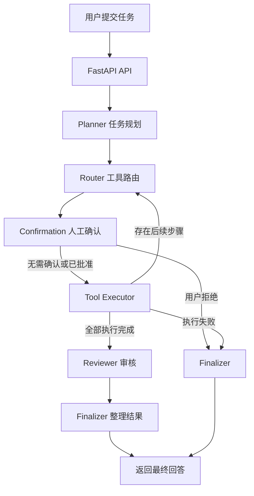

# LangGraph 多工具智能任务执行 Agent

一个基于 **LangGraph + FastAPI + DeepSeek** 构建的多工具智能任务执行 Agent。系统能够理解用户的自然语言任务，自动制定执行计划，调用不同工具完成任务，并通过 Reviewer 节点审核执行结果。

项目重点实现了多步骤任务规划、工具路由、人工确认、异常处理与自动重试、执行结果审核以及 API 接口服务。

## 1. 项目介绍

传统的大语言模型应用通常以单轮问答为主，面对需要多个步骤、多个工具协同完成的复杂任务时，缺乏明确的流程管理和执行状态控制。

本项目基于 LangGraph 构建状态驱动的 Agent 工作流，将复杂任务拆分为多个可执行步骤，通过 Planner、Router、Tool Executor、Reviewer 等节点协同完成任务。

用户只需要输入自然语言任务，Agent 就可以自动规划执行步骤，并根据任务需求调用对应工具。

**项目示例：**

用户输入：

> 计算 10、20、30 的平均值，并将计算结果整理成 Markdown 报告。

Agent 自动完成：

1. Planner 分析任务，生成执行计划。
2. Router 选择 Calculator 工具。
3. Calculator 计算平均值，得到 20。
4. Router 选择 File Writer 工具。
5. Confirmation 暂停工作流，等待用户授权。
6. 用户批准后，File Writer 生成 Markdown 报告。
7. Reviewer 检查任务步骤、工具调用和执行结果。
8. Finalizer 整理执行结果并返回最终回答。

## 2. 技术栈

| 技术 | 用途 |
|---|---|
| Python 3.11 | 项目开发语言 |
| LangGraph | Agent 工作流编排与状态管理 |
| LangChain | 大语言模型调用及消息管理 |
| DeepSeek API | 任务规划与文本摘要 |
| FastAPI | 后端 API 服务 |
| Pydantic | 数据模型及参数校验 |
| Pydantic Settings | 环境变量和配置管理 |
| Pytest | 自动化测试 |
| Git | 版本管理 |

## 3. 系统架构

### 3.1 整体工作流



### 3.2 核心节点说明

| 节点 | 主要职责 |
|---|---|
| Planner | 理解用户任务，生成结构化执行计划 |
| Router | 根据当前步骤选择工具，并进行白名单和参数校验 |
| Confirmation | 对需要授权的操作暂停工作流，等待用户批准或拒绝 |
| Tool Executor | 调用对应工具，记录执行结果并处理异常 |
| Reviewer | 检查任务步骤、工具调用记录、执行结果及文件生成情况 |
| Finalizer | 整理工具执行结果，生成最终回答 |

各节点通过共享 AgentState 传递任务状态，利用 LangGraph StateGraph 实现工作流的循环执行和条件路由。

## 4. 核心功能

### 4.1 多步骤任务规划

基于 DeepSeek API 实现任务规划，将用户的自然语言任务转换为结构化执行步骤。

目前 Planner 支持生成最多 5 个任务步骤，并结合工具白名单限制可执行操作。

### 4.2 多工具调用

目前实现三个工具：

**Calculator**
- 加法、减法、乘法、除法和平均值计算。
- 校验数字类型及运算类型。
- 检查除零、无效数值和计算结果范围。

**Text Summarizer**
- 基于大语言模型实现文本摘要。
- 支持中文文本处理。
- 限制输入长度，最多 12000 个字符。
- 对用户原文中的潜在恶意指令设置提示词边界。

**File Writer**
- 支持生成 Markdown 报告。
- 统一保存至项目 outputs 目录。
- 限制文件名、扩展名及写入路径。
- 防止通过目录路径和符号链接绕过目录限制。

### 4.3 人工确认机制

基于 LangGraph interrupt 实现人工确认机制。

对于 File Writer 操作，系统会先生成确认信息，展示目标文件名和文件内容预览。

用户可以选择：

- 批准：恢复工作流，继续执行文件写入。
- 拒绝：取消任务，不执行文件写入。

通过 Checkpointer 保存暂停的工作流状态，并使用 thread_id 恢复原任务。

### 4.4 异常处理与自动重试

实现工具执行异常分类和有限重试机制：

- 区分可重试异常和业务错误。
- 网络连接、超时等符合条件的异常可以触发重试。
- 默认最多额外重试 2 次。
- 达到最大重试次数后终止任务。
- 记录异常类型、重试次数及工具执行耗时。

### 4.5 执行结果审核

Reviewer 对任务执行结果进行规则校验：

- 检查所有任务步骤是否完成。
- 检查工具调用记录是否完整。
- 检查工具执行结果是否有效。
- 检查生成的 Markdown 文件是否真实存在。

审核通过后，由 Finalizer 生成最终回答。

### 4.6 日志与会话追踪

项目采用 Python logging 统一管理日志。

主要功能：

- 控制台和文件双重输出。
- 日志文件自动轮转。
- 单个日志文件最大 5 MB，保留 3 个备份。
- 记录任务执行时间和工具耗时。
- 使用 thread_id 关联同一任务的完整执行日志。
- 对常见 API Key、Token 和密码格式进行日志脱敏。

## 5. 项目目录

```text
langgraph-agent/
│
├── app/
│   ├── agent/
│   │   ├── graph.py
│   │   ├── nodes.py
│   │   ├── state.py
│   │   └── confirmation.py
│   │
│   ├── schemas/
│   │   ├── agent.py
│   │   └── api.py
│   │
│   ├── services/
│   │   └── llm_service.py
│   │
│   ├── tools/
│   │   ├── calculator.py
│   │   ├── text_summarizer.py
│   │   └── file_writer.py
│   │
│   ├── utils/
│   │   └── logger.py
│   │
│   ├── config.py
│   └── main.py
│
├── tests/
│   ├── test_agent_e2e.py
│   ├── test_agent_retry.py
│   ├── test_api.py
│   ├── test_calculator.py
│   ├── test_confirmation.py
│   ├── test_confirmation_interrupt.py
│   ├── test_file_writer.py
│   ├── test_graph.py
│   ├── test_graph_confirmation.py
│   ├── test_logger.py
│   ├── test_planner.py
│   ├── test_reviewer.py
│   ├── test_router.py
│   ├── test_text_summarizer.py
│   └── test_tool_executor.py
│
├── outputs/
│   └── .gitkeep
│
├── logs/
│
├── .env.example
├── .gitignore
├── README.md
└── requirements.txt
```

## 6. 环境配置

### 6.1 环境要求

- Python 3.11
- pip
- DeepSeek API Key

### 6.2 克隆项目

```bash
git clone <你的GitHub仓库地址>
cd langgraph-agent
```

### 6.3 创建虚拟环境

Windows PowerShell：

```powershell
python -m venv .venv

.venv\Scripts\Activate.ps1
```

### 6.4 安装依赖

```bash
python -m pip install -r requirements.txt
```

### 6.5 配置环境变量

复制环境变量示例文件：

```powershell
Copy-Item .env.example .env
```

编辑 `.env`：

```dotenv
DEEPSEEK_API_KEY=你的DeepSeek_API_Key
DEEPSEEK_BASE_URL=https://api.deepseek.com
DEEPSEEK_MODEL=deepseek-flash

DEBUG=false

MAX_ITERATIONS=5
MAX_RETRIES=2
TOOL_TIMEOUT=15
```

注意：

- 将 `DEEPSEEK_API_KEY` 替换为自己的 API Key。
- `.env` 仅用于本地环境配置，不要提交到 Git 仓库。
- 实际使用的模型名称可以根据可用模型进行调整。

## 7. 启动项目

在项目根目录执行：

```bash
uvicorn app.main:app --reload
```

服务启动后：

健康检查：

```text
http://127.0.0.1:8000/health
```

Swagger API 文档：

```text
http://127.0.0.1:8000/docs
```

## 8. API 接口说明

目前提供以下接口：

| 请求方式 | 接口 | 功能 |
|---|---|---|
| GET | `/health` | 服务健康检查 |
| POST | `/api/agent/run` | 启动 Agent 任务 |
| POST | `/api/agent/confirm` | 批准或拒绝人工确认 |

### 8.1 启动 Agent 任务

接口：

```http
POST /api/agent/run
```

请求示例：

```json
{
  "goal": "计算10、20、30的平均值，并生成Markdown报告"
}
```

任务执行过程中，如果遇到需要人工确认的操作，接口会返回：

```json
{
  "status": "waiting_for_confirmation",
  "requires_confirmation": true,
  "thread_id": "xxxxxxxx-xxxx-xxxx-xxxx-xxxxxxxxxxxx",
  "confirmation_request": "需要用户确认后才能执行以下操作..."
}
```

### 8.2 人工确认

接口：

```http
POST /api/agent/confirm
```

批准操作：

```json
{
  "thread_id": "xxxxxxxx-xxxx-xxxx-xxxx-xxxxxxxxxxxx",
  "approved": true
}
```

拒绝操作：

```json
{
  "thread_id": "xxxxxxxx-xxxx-xxxx-xxxx-xxxxxxxxxxxx",
  "approved": false
}
```

任务成功执行后，返回最终结果、审核状态和工具执行记录。

对于不存在的会话返回 HTTP 404；对于没有待处理确认操作的会话返回 HTTP 409。

## 9. 测试与验证

项目使用 Pytest 编写自动化测试，覆盖：

- Calculator 数学计算。
- Text Summarizer 文本摘要。
- File Writer 文件生成与路径安全。
- Planner 任务规划。
- Router 工具路由。
- Tool Executor 工具执行。
- 自动重试机制。
- 人工确认与工作流恢复。
- Reviewer 任务审核。
- Finalizer 最终结果整理。
- FastAPI API 接口。
- 日志模块。

执行全部测试：

```powershell
python -m pytest -v
```

**当前本地测试记录：**

| 项目 | 结果 |
|---|---:|
| 测试用例数量 | 63 |
| 通过数量 | 63 |
| 失败数量 | 0 |
